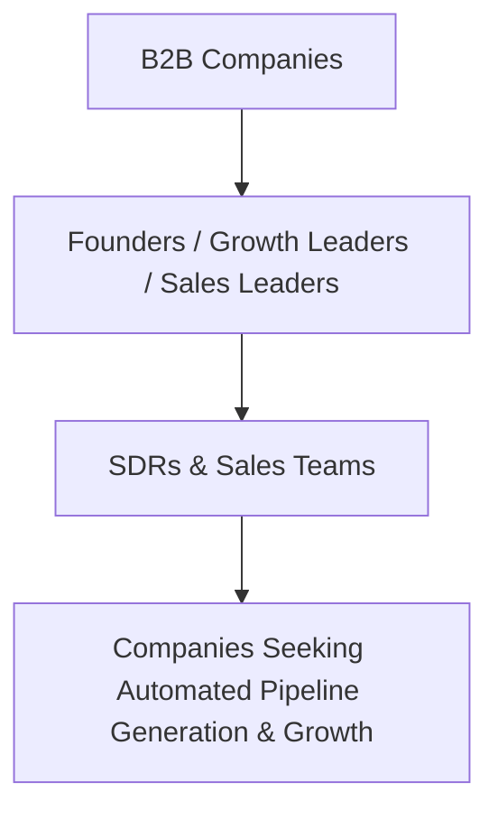
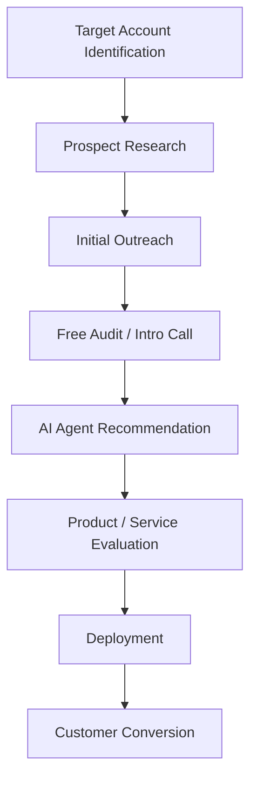
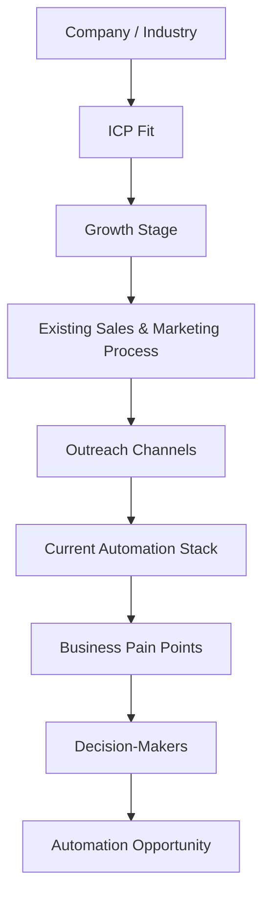
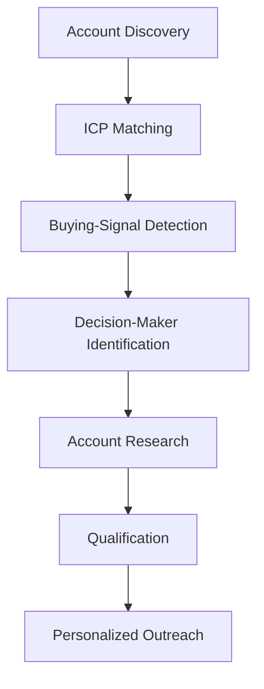

## *Company Type / Size:*

100XAI is a **B2B AI automation company** focused on helping businesses automate sales, marketing, outreach, content, and other growth-related activities using autonomous AI agents.

The company positions itself as a **“fully-autonomous AI Growth Stack for B2B teams”**, with AI agents capable of prospecting, outreach, content creation, follow-ups, and sales-related activities without requiring proportional increases in headcount.

100XAI was founded by **Ayush Kapoor**, with **Mohan Verma** listed as Co-Founder. The company appears to operate as a relatively lean, founder-led AI automation business rather than a large enterprise SaaS organization.

Its product portfolio includes AI-powered solutions for **LinkedIn outreach, cold email, email conversations, content creation, SEO, backlinks, social media, and content repurposing**.

---

## *Target Customers / ICP:*

100XAI primarily targets **B2B companies and growth-focused businesses** that want to automate repetitive sales and marketing activities without significantly increasing headcount.

The company explicitly identifies several customer segments, including:

- **SaaS Startups**
- **B2B Agencies**
- **D2C Brands**
- **FinTech companies**
- **Consulting companies**
- **E-commerce businesses**
- **Scale-ups**

Its messaging also specifically targets **founders, growth teams, sales teams, and enterprises scaling their sales operations**.

Its primary B2B ICP can therefore be described as:

---

## *Sales Process:*

100XAI appears to use a **demo / consultation-led B2B SaaS and AI-services sales model**, combined with a free-start / low-friction acquisition approach.

Its website offers a **free start**, a free audit, and a **15-minute introductory call**, allowing prospects to discuss their business and determine which AI agents should be deployed.

The observable sales journey can therefore be represented as:

For larger or more complex deployments, the process can additionally involve understanding the company's **ICP, brand voice, product information, competitive context, CRM, email infrastructure, and existing growth workflows** before deployment.

The exact internal CRM and sales stages used by 100XAI are **not publicly disclosed**, so this represents a research-based summary of its observable customer acquisition process.

---

## *Prospect Identification & Research:*

Prospect identification is particularly important for 100XAI because the company itself sells **AI-powered prospecting and outreach automation**.

Its agents can monitor target accounts, identify relevant opportunities, generate personalized LinkedIn interactions, send cold emails, manage follow-ups, and handle incoming email conversations.

For 100XAI's own sales process, prospect research would potentially involve understanding:

A particularly relevant prospecting challenge for 100XAI is identifying businesses where **manual sales and marketing work is sufficiently expensive or inefficient to justify adopting an AI automation solution**.

The company's exact internal prospect-research tools and databases are **not publicly disclosed**.

---

## *Tools Currently Used:*

100XAI does not publicly disclose its complete **internal sales and prospecting technology stack**.

However, its product integrates with existing sales infrastructure and specifically mentions **CRM + email integrations**, while its cold-email offering has native integrations with **Instantly and Smartlead**.

The company's AI growth stack includes:

- **LinkedIn Comment Automation**
- **LinkedIn DM Outreach**
- **Cold Email Outreach**
- **Email Conversation Agent**
- **CRM integrations**
- **Instantly / Smartlead integrations**
- **SEO & AEO automation**
- **Content Repurposing**
- **Social Media Publishing**
- **Backlink Acquisition**

These should be treated as **product capabilities rather than confirmed tools used internally by the 100XAI sales team**.

**Internal CRM / Prospecting Stack:** Not publicly disclosed

---

## *Biggest Pain Points:*

100XAI does not publicly disclose specific problems within its own internal sales organization, so the following should be treated as **potential pain points to validate**.

Because 100XAI sells a broad AI automation stack to different types of businesses, one potential challenge is **identifying the right prospects that have both strong ICP fit and an immediate need for automation**.

Potential pain points include:

- **Identifying businesses with strong AI-automation potential**
- **Finding companies actively investing in sales and growth**
- **Identifying the correct decision-makers**
- **Understanding each prospect's existing sales and marketing stack**
- **Determining which repetitive workflows should be automated**
- **Personalizing outreach across different industries**
- **Prioritizing high-value accounts**
- **Identifying prospects with immediate buying intent**
- **Demonstrating ROI before the sales conversation**
- **Managing multiple customer segments with different automation requirements**

For an AI SDR / sales-intelligence solution, the strongest potential opportunity would therefore be:

However, because **100XAI already provides AI-powered prospecting and outreach**, any proposed AI SDR solution would need to provide differentiated intelligence rather than simply duplicating its existing capabilities.

---

## *Time / Cost Involved:*

100XAI's exact internal expenditure on SDRs, sales prospecting, and customer acquisition is **not publicly disclosed**.

However, the company specifically positions its product around reducing the amount of manual work required for growth teams. It claims that AI agents can run outreach, content, and inbox management continuously, and advertises **600+ hours saved per week** across its automation offering.

100XAI also states that customers can go from kickoff to live AI agents in approximately **7 days**, with more complex deployments taking **10–14 days**.

**Internal SDR / Sales Cost:** Not publicly disclosed

**Potential Time Impact:** High

**Existing Automation Level:** Very High

**Potential Additional Automation Opportunity:** Medium

The biggest opportunity would therefore be **higher-level sales intelligence and decision-making**, rather than automating basic outreach that 100XAI already handles itself.

---

## *Potential Willingness to Pay:*

100XAI appears to have **High potential willingness to pay** for technologies that can improve its own customer acquisition and sales intelligence, although this should be validated through direct interviews.

The company operates directly in the **AI automation and B2B growth market**, meaning sales efficiency is directly connected to its business model.

Its current AI Growth Stack is priced at **$499/month**, and the company offers customized AI-agent deployments for businesses with different growth requirements.

A complementary AI SDR / intelligence platform could potentially provide value by helping 100XAI:

- **Identify high-fit B2B accounts**
- **Detect companies actively seeking automation**
- **Identify relevant founders and growth leaders**
- **Research the prospect's existing sales stack**
- **Identify automation opportunities before outreach**
- **Prioritize accounts based on buying intent**
- **Generate deeper account-level intelligence**
- **Improve conversion rates from outbound campaigns**

**Assessment: High**

**Reason:** B2B growth-focused company + direct dependence on outbound acquisition + AI automation positioning + existing willingness to pay for growth infrastructure + strong relevance of sales automation to its own business model.

However, **willingness to pay for a generic AI SDR would likely be lower**, because 100XAI already has AI agents for LinkedIn outreach, cold email, email conversations, prospecting, lead qualification, and CRM synchronization.

The stronger customer-validation hypothesis is:

> **100XAI may pay for an AI SDR if it provides intelligence and capabilities that complement its existing automation stack rather than replacing what its current agents already do.**

---

## *Sources / Evidence:*

### 1. 100XAI — Official Website

Company positioning, AI Growth Stack, target customers, AI agents, integrations, pricing, deployment process, and customer outcomes.

https://www.100xai.co/?utm

### 2. 100XAI — AI Growth Stack

Evidence of the company's autonomous AI agents for prospecting, LinkedIn outreach, cold email, email conversations, content, SEO, and other growth activities.

### 3. 100XAI — How It Works

Evidence of the **Discover & Strategise → Train & Deploy → Monitor & Optimise** implementation process and the company's 7-day deployment positioning.

### 4. 100XAI — Pricing / Product Information

Evidence of the **$499/month AI Growth Stack**, five active AI agents, CRM/email integrations, reporting, and human approval mode.

### 5. 100XAI — Team

Evidence identifying **Ayush Kapoor as Founder** and **Mohan Verma as Co-Founder**.

---
