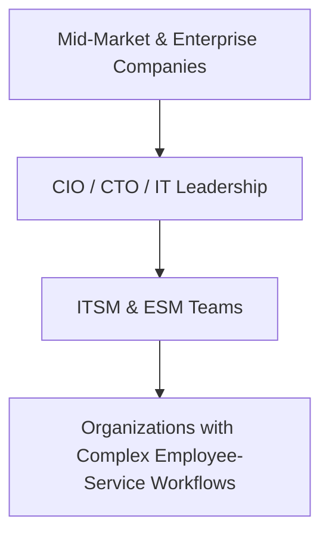
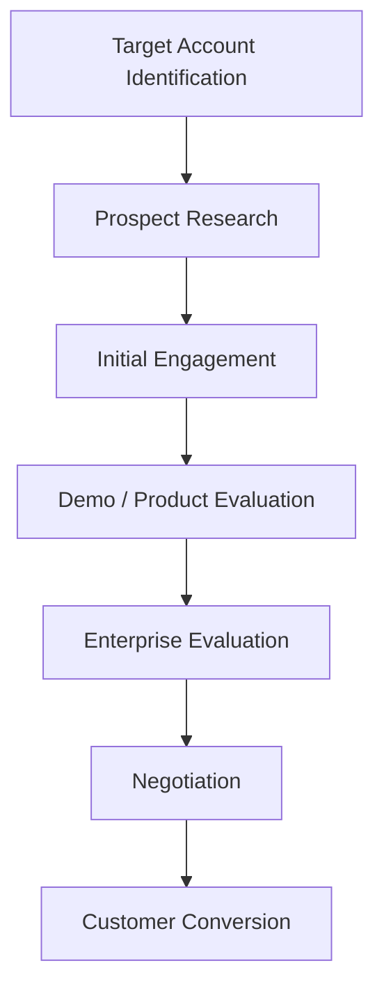
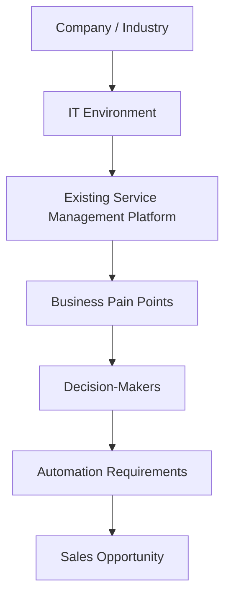

## *Company Type / Size:*

Atomicwork is a **B2B SaaS and Enterprise AI company** focused on IT Service Management (ITSM), Enterprise Service Management (ESM), and AI-powered workplace automation. Founded in **2022** and headquartered in Palo Alto, California, the company currently lists itself in the **51–200 employee range** on LinkedIn.

Atomicwork has raised **$25M+ in Series A funding** from investors including Khosla Ventures, Battery Ventures, Peak XV Partners, Blume Ventures, and Z47.

The company provides an AI-native service-management platform designed for **enterprise IT teams and business functions such as HR, Finance, and Facilities**. Its customers include organizations such as Zuora, HighLevel, HighRadius, Skydio, and Catalyst Education.

---

## *Target Customers / ICP:*

Atomicwork primarily targets **medium-to-large enterprises** that have complex IT and employee-service requirements.

Its main buyers and users include **CIOs, CTOs, IT leaders, HR teams, Finance teams, and enterprise service-management teams**. Atomicwork's platform is positioned as an alternative to traditional service-management platforms such as ServiceNow, Jira Service Management, and Freshworks.

Its primary B2B ICP can therefore be described as:

---

## *Sales Process:*

Atomicwork follows an **enterprise sales and demo-driven SaaS model**. Its website prominently uses a "Book a demo" call-to-action, indicating that prospective enterprise customers are expected to engage with the sales team before purchasing.

The company's enterprise sales journey can be represented as:

Because Atomicwork sells an enterprise platform that can replace or integrate with existing service-management systems, the buying process can involve multiple stakeholders and evaluation of existing workflows, technology, and business requirements.

The exact internal sales stages used by Atomicwork are not publicly disclosed, so this represents a research-based summary of its observable enterprise-sales journey.

---

## *Prospect Identification & Research:*

Atomicwork targets a clearly defined enterprise audience, particularly **CIOs, CTOs, IT leaders, and organizations using or evaluating ITSM/ESM platforms**. Its customer stories show organizations replacing existing platforms such as ServiceNow, Jira Service Management, and Freshworks with Atomicwork.

This means prospect research can involve understanding a company's **size, IT environment, existing service-management platform, employee-support requirements, automation needs, and potential business challenges**.

Potential prospect-research areas include:

Atomicwork's exact internal prospecting tools and databases are not publicly disclosed.

---

## *Tools Currently Used:*

Atomicwork does not publicly disclose its complete internal sales technology stack, so specific CRM, prospecting, or SDR tools cannot be reliably confirmed.

However, Atomicwork's product integrates with and works across enterprise tools and systems such as **Slack, Microsoft SharePoint, Confluence, and other workplace applications**. Its platform is designed to bring service requests and workflows into the tools employees already use.

These integrations represent **product capabilities**, not necessarily tools used internally by Atomicwork's sales team.

**Internal CRM / Prospecting Stack: Not publicly disclosed**

---

## *Biggest Pain Points:*

Atomicwork does not publicly state specific problems with its own sales process, so these should be treated as **potential pain points to validate**.

As an enterprise SaaS company selling a relatively complex product to large organizations, Atomicwork's sales team may need to spend significant effort identifying the right accounts, researching their existing IT environment, understanding their current service-management platform, and identifying the relevant decision-makers.

Potential pain points include:

- **Identifying enterprises that match the ideal customer profile**

- **Researching existing ITSM / ESM platforms**

- **Finding the correct CIO, CTO, IT, and business stakeholders**

- **Understanding each organization's IT-service challenges**

- **Identifying companies showing potential buying or replacement signals**

- **Personalizing outreach for different enterprise accounts**

- **Prioritizing high-value accounts**

- **Managing multi-stakeholder enterprise sales processes**

For an AI-powered SDR, the strongest opportunity would be to automate **account discovery, company research, buying-signal detection, qualification, stakeholder identification, and personalized outreach**.

---

## Time / Cost Involved

Atomicwork's exact internal expenditure on sales prospecting and SDR activities is **not publicly disclosed**.

However, the company's enterprise-focused sales model requires substantial research before engaging potential customers. Sales teams may need to understand the prospect's existing service-management infrastructure, identify decision-makers, research business requirements, and prepare a relevant value proposition.

Atomicwork's enterprise customer base and high-value software positioning also mean that **each qualified enterprise opportunity can potentially have significant business value**.

**Internal SDR / Sales Cost:** Not publicly disclosed

**Potential Time Impact:** High

**Potential Automation Opportunity:** High

An AI-powered SDR could reduce manual effort in **account identification, prospect research, qualification, buying-signal detection, and personalized outreach**, allowing enterprise sales representatives to focus more on demos, negotiations, and closing.

---

## *Potential Willingness to Pay:*

Atomicwork appears to have **High potential willingness to pay** for a better sales and prospecting workflow, although this has not been directly confirmed through a customer interview.

The company is a funded enterprise SaaS business with a **51–200 employee team**, a dedicated enterprise customer base, and a product positioned for CIOs and IT leadership. It has raised **$25M+ in Series A funding**, indicating significant investment in enterprise growth.

An AI-powered SDR could potentially provide value by helping Atomicwork identify high-fit enterprise accounts, research their existing ITSM environment, identify relevant stakeholders, detect buying signals, and personalize outreach at scale.

**Assessment: High**

**Reason:** Enterprise SaaS model + dedicated enterprise market + high-value customers + funded growth-stage company + complex prospect-research requirements.

This should still be validated through direct interviews before concluding that Atomicwork would definitely purchase an AI-powered SDR solution.

---

## *Sources / Evidence:*

### 1. Atomicwork — About

Company background, mission, leadership, investors, enterprise positioning, and customer information.

https://www.atomicwork.com/company/about

### 2. LinkedIn — Atomicwork

Company size, industry, headquarters, founding year, and product positioning.

https://www.linkedin.com/company/atomicworkhq

### 3. Atomicwork — Official Website

Product positioning, target users, AI-native ITSM/ESM platform, and enterprise use cases.

https://www.atomicwork.com/

### 4. Atomicwork — AI Service Desk

Evidence of the demo-driven enterprise sales model and AI-powered service-desk offering.

https://www.atomicwork.com/solutions/ai-service-desk

### 5. Atomicwork — Customer Stories

Evidence of enterprise customers and organizations replacing platforms such as ServiceNow, Jira Service Management, and Freshworks.

https://www.atomicwork.com/customers

### 6. Atomicwork — Series A Funding

Evidence of **$25M+ Series A funding** and the company's growth-stage enterprise focus.

https://www.atomicwork.com/blog/atomicwork-series-a-funding

### 7. Atomicwork — Enterprise Service Management

Evidence of Atomicwork's expansion across **IT, HR, Finance, and Facilities** and its enterprise service-management use cases.

https://www.atomicwork.com/solutions/enterprise-service-management-platform

---
