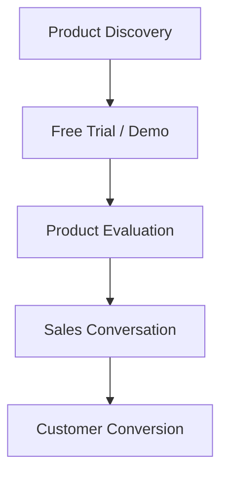
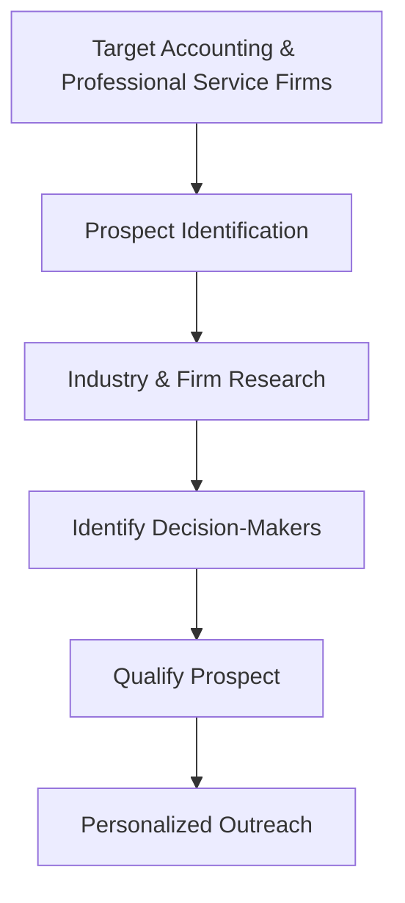

## *Company Type / Size*:

Cone is a **B2B SaaS company focused on workflow and work-management software for accounting and professional service firms**. Its platform brings together proposals, billing, payments, client management, projects, time tracking, and other workflows into a unified system.

Cone was founded in **2022** and is a **Y Combinator Summer 2022 (YC S22)** company. LinkedIn currently lists Cone in the **2–10 employee** range, indicating that it operates with a very lean team. The company is headquartered in San Francisco and is backed by investors including Y Combinator, General Catalyst, XYZ.vc, and Khosla Ventures.

Despite its small team size, Cone serves a large base of accounting and bookkeeping businesses, with its website stating that it is **trusted by thousands of accountants and bookkeepers**.

---

## *Target Customers / ICP:*

Cone primarily targets **accounting firms, bookkeeping firms, CPAs, and other professional service businesses** that need to manage proposals, client relationships, projects, billing, payments, and related workflows.

Its product is designed for organizations ranging from **individuals and small firms to mid-market and larger firms**, with different plans aimed at small teams, growing businesses, and larger organizations.

Its ICP can therefore be broadly described as:

**Accounting & Professional Services Firms → Small & Mid-Sized Businesses → Firms with recurring client, proposal, billing and workflow requirements**

---

## *Sales Process*

Cone appears to use a **hybrid self-serve and sales-assisted SaaS model**. Smaller customers can start through a free trial and directly purchase subscription plans, while larger teams are encouraged to **contact sales** for customized pricing.

The website provides a **14-day free trial**, self-service pricing, product information, and a “Book a Demo” option. For teams with more than 20 users, Cone provides a contact-sales route, suggesting a more sales-assisted process for larger accounts.

Cone also provides a structured sales pipeline within its own product, where deals can move through stages such as **New Deal → In Progress → Proposal → Closed**. This demonstrates the type of sales lifecycle the company’s product is designed to support, although it should not be treated as confirmed evidence of Cone’s own internal sales stages.

**Publicly observable sales journey:** 

---

## *Prospect Identification & Research:*

Public information about Cone's **internal prospecting and SDR workflow is limited**, so its exact methods for identifying and researching prospects cannot be confirmed from public sources.

However, Cone's publicly visible marketing strategy is strongly focused on reaching **accounting and professional-service audiences**. The company publishes industry-specific content around accounting software, proposal management, practice management, client acquisition, and business growth. It also discusses channels such as **content marketing, social media, networking, partnerships, email marketing, webinars, referrals, and targeted advertising** for reaching accounting audiences.

This suggests that Cone's customer acquisition strategy is likely to involve **highly targeted prospect identification based on industry and firm characteristics**, rather than selling to a broad general-market audience.

For a potential AI-powered SDR, this creates an opportunity to identify accounting and professional-service firms that match Cone's ICP and research relevant signals such as firm size, services offered, technology adoption, and potential workflow needs.

**Important:** The specific prospecting channels used by Cone's internal sales team are **not publicly disclosed**, so these should be treated as areas for further validation rather than confirmed internal processes.

---

## *Tools Currently Used:*

Cone does not publicly disclose its complete **internal sales technology stack**, so specific CRM, prospecting, or SDR tools used by its own sales team cannot be reliably confirmed.

However, Cone's own product includes several sales-related capabilities, including **CRM, client and contact management, sales pipeline and lead management, proposals, integrated email, and engagement tracking**.

Cone also supports integrations with tools such as **Zapier, Gmail, Outlook, QuickBooks Online, Xero, Stripe, and GoCardless**, although these integrations represent product capabilities and should not automatically be interpreted as tools used internally by Cone's own sales team.

**Confirmed publicly:** Cone's product provides CRM and sales-pipeline functionality.

**Not publicly confirmed:** Cone's internal use of tools such as Apollo, HubSpot, Salesforce, Clay, or similar prospecting platforms.

---

## *Biggest Pain Points*:

Cone does not publicly state specific complaints about its own sales process, so the following should be treated as **potential pain points to validate**, rather than confirmed internal problems.

As a **2–10 person B2B SaaS company** serving a specialized but potentially large market, Cone operates with a relatively lean team while targeting thousands of accounting and bookkeeping businesses. This creates a potential need to make customer acquisition and sales activities highly efficient.

Potential pain points include:

- **Identifying accounting and professional-service firms that closely match the ICP**
- **Researching prospects before outreach**
- **Finding the appropriate decision-makers within target firms**
- **Personalizing outreach for different types of professional-service businesses**
- **Prioritizing the most promising prospects**
- **Maintaining an efficient sales process with a very lean team**
- **Balancing product development, customer support, marketing, and sales activities**

For an AI-powered SDR, the strongest potential opportunity is to **automate prospect discovery, research, qualification, and prioritization**, allowing a lean team to spend more time on high-value sales conversations.

---

## *Time / Cost Involved:*

Cone's exact internal expenditure on sales prospecting and SDR activities is **not publicly disclosed**.

However, its **2–10 employee team size** means that sales and customer-acquisition activities are likely to be handled by a relatively small number of people, making individual team members' time particularly valuable.

Cone's own product positioning also emphasizes **automation, time savings, and reducing manual work**. Its website highlights automated billing, payment collection, workflows, and other repetitive processes, while customer testimonials specifically mention saving time on manual invoicing.

Therefore, the potential cost of the current prospecting workflow is primarily associated with **human time spent identifying, researching, qualifying, and engaging potential customers**, along with any software used to support these activities.

**Internal SDR cost:** Not publicly disclosed  
**Potential Time Impact:** Medium–High  
**Potential Automation Opportunity:** High

---

## *Potential Willingness to Pay:*

Cone appears to have a **Medium–High potential willingness to pay** for a better sales workflow, although this has not been directly confirmed through an interview or public statement.

The company is itself a B2B SaaS provider with a paid subscription model and actively sells its software to businesses. Its pricing ranges across different plans, with higher-tier options for growing teams and custom pricing for larger organizations.

The company also demonstrates a willingness to invest in **automation and workflow software**, which is closely aligned with the value proposition of an AI-powered SDR.

A potential AI SDR could provide value by reducing the manual effort involved in **prospect identification, research, qualification, and personalized outreach**, particularly for a lean startup team.

**Assessment: Medium–High**

**Reason:** Lean team + B2B SaaS sales model + existing investment in workflow automation + need to reach a clearly defined business audience.

This should still be validated through direct customer interviews before claiming that Cone would definitely pay for the solution.

---

## Sources / Evidence:

1. **Y Combinator — Cone**  
   Company profile, YC S22 status, product description, and company background.
   https://www.ycombinator.com/companies/cone?utm

2. **LinkedIn — Cone (YC S22)**  
   Company size, founding year, headquarters, industry, B2B/SaaS positioning, and investor information.
   https://www.linkedin.com/company/getcone?utm

3. **Cone — Pricing**  
   Pricing structure, free trial, customer segments, sales contact for larger teams, integrations, and customer testimonials.
   https://www.getcone.io/pricing?utm

4. **Cone Help Center — Deals Overview**  
   Evidence of structured deal and sales-pipeline stages within Cone's product.
   https://help.getcone.io/hc/cone-help-center/articles/deals-overview?utm

5. **Cone — Lead Generation for Accounting Firms**  
   Evidence of marketing and lead-generation channels relevant to Cone's target market.
   https://www.getcone.io/blog/get-accounting-leads?utm

6. **Cone — Marketing Strategies for Accounting Firms**  
   Evidence covering content marketing, social media, partnerships, email marketing,  networking, events, referrals, and other acquisition channels.
   https://www.getcone.io/blog/marketing-for-accountants?utm

