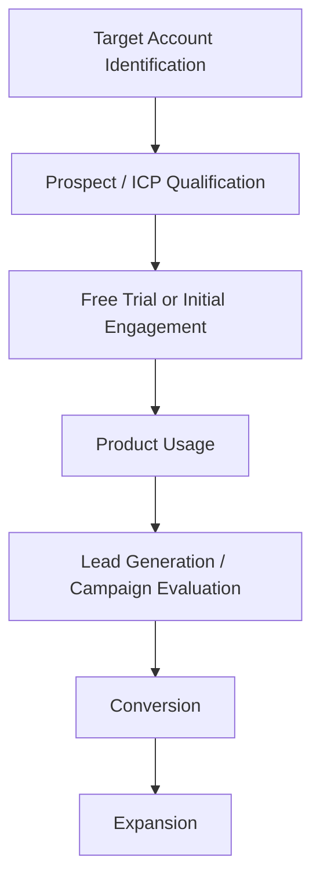
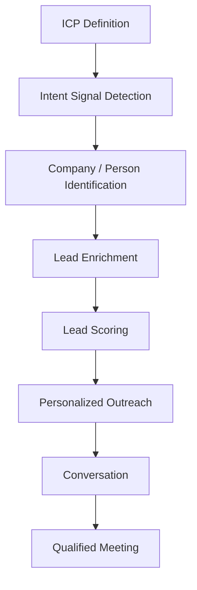

## *Company Type / Size:*

Gojiberry AI is a **B2B SaaS and AI-powered sales / GTM company** focused on helping B2B companies identify high-intent prospects and automate outbound sales. The company describes itself as an **“AI GTM Team”** or **“GTM Brain”** for B2B sales teams.

Gojiberry AI was founded in **2025** by **Pierre-Eliott Lallemant, Dylan Teixeira, and Romàn Czerny** and was accepted into **Y Combinator's Spring 2026 batch**. YC currently lists the company with a **7-person team** and San Francisco as its location.

The company focuses on replacing fragmented sales tools such as prospecting databases, enrichment platforms, CRMs, and outreach tools with an integrated AI-powered workflow. Its platform identifies buying-intent signals, enriches leads, generates personalized outreach, handles conversations, and helps book qualified meetings.

---

## *Target Customers / ICP:*

Gojiberry AI primarily targets **B2B companies, founders, small sales teams, sales organizations, and outbound agencies** that want to generate qualified pipeline without relying entirely on traditional cold-lead lists.

Its website specifically positions the product for **founders and operators running their own outbound**, as well as **sales teams with 5+ members and outbound agencies** looking to scale multichannel outreach.

The platform is particularly relevant for companies that have:

- B2B sales models
- Outbound sales teams
- Defined ICPs
- High-value products or services
- Long or moderate sales cycles
- Need for continuous prospect generation
- Existing LinkedIn / email outreach processes

Gojiberry's primary B2B ICP can therefore be described as:

---

## *Sales Process:*

Gojiberry AI appears to use a combination of **product-led growth, free trials, self-serve SaaS, and demo-driven sales**.

Its website offers a **free trial** and promotes a $99/month Pro plan for founders and operators, while larger sales teams and outbound agencies are directed toward a demo/contact-sales motion.

Its observable sales journey can therefore be represented as:

For larger sales teams, the journey can additionally involve:

**Target Account → Demo → Product Evaluation → Sales Discussion → Conversion → Expansion**

Gojiberry itself is also heavily focused on outbound sales, meaning its own GTM process is closely connected to the problem its product solves.

The exact internal sales stages, CRM workflow, and SDR structure used by Gojiberry are **not publicly disclosed**, so the above represents a research-based summary of its observable sales model.

---

## *Prospect Identification & Research:*

Prospect identification is actually a **core part of Gojiberry AI's own product**, rather than simply an external activity performed by its sales team.

Gojiberry allows users to define an **Ideal Customer Profile (ICP)** and then identify prospects based on real-time buying-intent signals. These signals can include **job changes, hiring activity, fundraising, competitor engagement, keyword engagement, profile activity, and social interactions**.

The platform then enriches the identified leads with contact and company information and can generate personalized outreach.

Its prospect-research flow can therefore be represented as:

This is a particularly important point for our research because **Gojiberry is already solving a large portion of the traditional AI-SDR problem internally through its own product**.

---

## *Tools Currently Used:*

Gojiberry AI's complete **internal sales technology stack is not publicly disclosed**.

However, its product integrates with or works alongside several sales and AI platforms. Its website lists integrations including **HubSpot, Pipedrive, Claude, APIs, and MCP**, while its product also uses multiple data providers for lead enrichment.

The platform itself includes:

- **AI prospecting agents**
- **Warm-lead / intent-signal discovery**
- **Smart lead scoring**
- **Email and social outreach**
- **Unified inbox**
- **AI Copilot**
- **Email waterfall enrichment using 15+ data providers**
- **CRM integrations**
- **API / MCP integrations**

These are **product capabilities rather than confirmed internal tools used by Gojiberry's own sales team**.

**Internal CRM / Prospecting Stack:** Not publicly disclosed

---

## *Biggest Pain Points:*

Gojiberry AI's founders have publicly described the traditional B2B outbound process as fragmented, with teams relying on **scraping tools, CRMs, enrichment platforms, random lead lists, and manual outreach**.

The company specifically argues that traditional outbound often involves contacting people who are not currently interested, sending generic messages, and losing opportunities because follow-up is slow or inconsistent.

For Gojiberry itself, potential sales and growth pain points include:

- **Finding the highest-intent prospects at scale**
- **Continuously identifying new buying signals**
- **Converting free-trial users into paying customers**
- **Scaling outbound while maintaining personalization**
- **Managing a large number of potential leads**
- **Identifying which signals actually correlate with conversions**
- **Improving lead qualification**
- **Maintaining high reply and meeting-booking rates**
- **Competing in a crowded AI sales / GTM market**
- **Scaling customer acquisition efficiently with a small team**

Gojiberry already automates many traditional SDR activities through its own platform. Therefore, the strongest opportunity is **not simply another generic AI prospecting tool**.

A potential complementary AI solution would need to provide additional value around **deeper account intelligence, competitive research, enterprise-level account prioritization, market intelligence, or advanced sales analytics**.

---

## *Time / Cost Involved:*

Gojiberry's exact internal expenditure on sales and prospecting is **not publicly disclosed**.

However, its business model is heavily dependent on acquiring B2B customers and demonstrating measurable improvements in outbound performance. Since the company has a very small team, scaling customer acquisition efficiently is particularly important.

The company already automates significant portions of prospecting and outreach through its own AI agents. Its Pro plan, for example, includes **two AI agents prospecting 24/7 and up to 1,800 prospects contacted per month**.

This suggests that manual SDR workload is already substantially reduced through automation.

**Internal SDR / Sales Cost:** Not publicly disclosed

**Potential Time Impact:** Medium–High

**Existing Automation Level:** Very High

**Potential Additional Automation Opportunity:** Medium

The opportunity for another AI-SDR product would therefore need to focus on **areas not already covered by Gojiberry's core platform**, rather than duplicating prospect discovery and outreach.

---

## *Potential Willingness to Pay:*

Gojiberry AI has **High potential willingness to pay for complementary sales-intelligence or GTM technologies**, although this should be validated through direct customer or founder interviews.

The company operates directly in the B2B sales-automation market and has demonstrated strong early traction. Its YC profile reports **1,000+ paying customers**, while its website offers paid SaaS plans and a higher-touch sales model for larger teams and agencies.

The company is also actively building a broader **AI GTM team**, rather than simply a lead database. Its product already covers prospect discovery, enrichment, scoring, outreach, follow-ups, and meeting booking.

Therefore, Gojiberry could potentially pay for technologies that improve areas such as:

- **Advanced account intelligence**
- **Competitive intelligence**
- **Market research**
- **Enterprise account prioritization**
- **New buying-signal discovery**
- **Sales analytics**
- **Data quality / enrichment**
- **Conversion prediction**
- **GTM strategy automation**

**Assessment: High**

**Reason:** Rapidly growing B2B SaaS company + strong sales-centric business model + YC backing + large early customer base + direct dependence on efficient GTM execution.

However, **willingness to purchase another AI-SDR/prospecting platform should be treated as low-to-medium**, because Gojiberry already provides much of that functionality itself.

This distinction is important for our customer validation: **Gojiberry may be a stronger prospect for a complementary sales-intelligence solution than for another generic AI SDR.**

---

## *Sources / Evidence:*

### 1. Gojiberry AI — Official Website

Product positioning, pricing, AI agents, prospecting, lead enrichment, CRM integrations, and target customers.

https://gojiberry.ai/?utm

### 2. Y Combinator — Gojiberry AI

Company founding information, founders, team size, YC batch, traction, customer numbers, and product positioning.

https://www.ycombinator.com/companies/gojiberry-ai?utm

### 3. Gojiberry AI — Customer Case Studies

Evidence of customer use cases, intent-driven outbound, meetings generated, and improved reply rates.

https://gojiberry.ai/case-study?utm

### 4. Founders Capital — Gojiberry AI

Evidence of the company's B2B outbound positioning, GTM automation, reported ARR growth, customer count, and product capabilities.

https://www.linkedin.com/posts/founders-capital-uk_portfolio-spotlight-gojiberry-ai-b2b-outbound-activity-7475940946552012801-rE3m?utm_

### 5. Y Combinator — Gojiberry AI LinkedIn Post

Evidence of Gojiberry's intent-signal approach, including job changes, hiring activity, competitor engagement, keyword engagement, and content interactions.

https://www.linkedin.com/posts/y-combinator_gojiberryai-is-a-gtm-brain-for-small-sales-activity-7443280719046606848-lkTe?utm

### 6. Crunchbase — GojiberryAI

Additional company information, founders, Paris/San Francisco location discrepancies across databases, business category, and funding information.

https://www.crunchbase.com/organization/gojiberryai?utm

---

