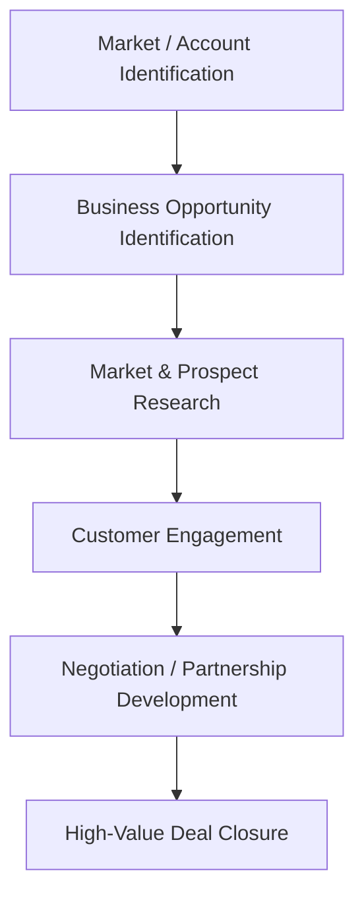
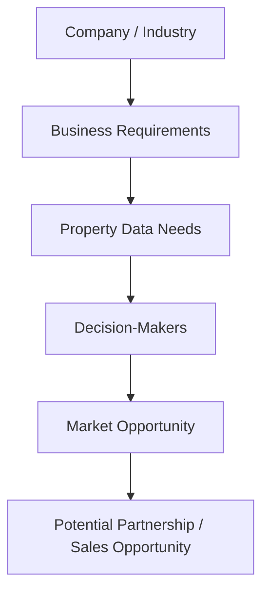

## *Company Type / Size:*

Landeed is a **PropTech and AI company** focused on property intelligence, verification, land records, and real-estate transactions in India. Founded in **2022** and headquartered in Hyderabad, Landeed is a **Y Combinator Summer 2022 (YC S22)** company. LinkedIn currently lists the company in the **11–50 employee range**, making it a relatively lean but growing technology company.

Landeed provides digital access to property documents and uses technology to simplify property due diligence, verification, registration, and related real-estate processes. The company states that it has provided **50 lakh+ documents to 10 lakh+ people**. Its enterprise offering targets organizations across **BFSI, real estate, and retail**, and Landeed states that it is trusted by Fortune India 500 companies.

---

## *Target Customers / ICP:*

Landeed serves both individual property users and **B2B customers such as real-estate companies, developers, brokers, housing finance companies, banks, and other enterprises** that require property data and verification.

Its enterprise solutions are particularly relevant for organizations involved in property transactions, lending, development, and due diligence. Landeed's website specifically identifies **developers, brokers, and housing finance companies** as users of its registration and post-registration solutions.

Its primary B2B ICP can therefore be described as:

**Real Estate & Property Companies → BFSI / Housing Finance → Developers → Brokers → Large Enterprises requiring property intelligence and verification**

---

## *Sales Process:*

Landeed has evidence of a dedicated **Business Development and Enterprise Sales function**. A current Landeed job listing describes the role as being responsible for identifying and pursuing new business opportunities, developing strategic partnerships, leading sales activities, and closing high-value deals.

The company specifically targets partnerships and business opportunities across the **real estate, technology, and government sectors**. The role also includes market analysis and collaboration with product, marketing, and operations teams.

Based on the publicly available information, Landeed's enterprise sales journey can be represented as:

The exact internal sales stages used by Landeed are not publicly disclosed, so the above represents a research-based summary of the publicly documented business-development process.

---

## *Prospect Identification & Research:*

Landeed's Business Development and Enterprise Sales role explicitly requires the company to **identify and pursue new business opportunities** and develop strategies for entering new markets and sectors. The role also involves identifying opportunities across real estate, technology, and government sectors and conducting **comprehensive market research** to identify trends, opportunities, and competitive threats.

This indicates that prospect identification and research are important parts of Landeed's enterprise-growth process. The team needs to identify organizations that could benefit from property intelligence, understand their business requirements, and determine where Landeed's solutions can create value.

Potential prospect-research areas include:

However, Landeed does not publicly disclose the exact tools or databases its sales team uses to find and research prospects.

---

## ***Tools Currently Used:***

Landeed does not publicly disclose its complete internal sales technology stack, so specific CRM, prospecting, or SDR tools used by its sales team cannot be reliably confirmed.

However, Landeed's core product itself is heavily technology-driven. Its platform provides access to **100+ property documents across 20+ states**, while its newer Terra platform uses AI to reason across property ownership, transactions, encumbrances, litigation, surveys, and other property records.

For the sales workflow specifically:

**Internal CRM / Prospecting Stack: Not publicly disclosed**

This should be kept as "not publicly disclosed" rather than assuming that Landeed uses tools such as Apollo, HubSpot, Salesforce, or Clay.

---

## *Biggest Pain Points:*

Landeed does not publicly state specific problems with its internal sales process, so the following should be treated as **potential pain points to validate** rather than confirmed complaints.

Because Landeed is expanding its enterprise business across multiple sectors and markets, its business-development team may need to handle a broad range of potential customers and partnerships. This can make **identifying high-value accounts, researching organizations, understanding their requirements, and prioritizing opportunities** time-consuming.

Potential pain points include:

- **Identifying high-value enterprise prospects**

- **Researching companies across multiple industries**

- **Finding the right decision-makers and stakeholders**

- **Understanding each prospect's property-data and verification requirements**

- **Prioritizing the most valuable business opportunities**

- **Entering new markets and identifying suitable partners**

- **Maintaining sufficient research before approaching enterprise prospects**

For an AI-powered SDR, the strongest potential opportunity would be to automate parts of **account discovery, company research, qualification, opportunity scoring, and personalized outreach**.

---

## *Time / Cost Involved:*

Landeed's exact internal spending on enterprise sales and business-development activities is **not publicly disclosed**.

However, its current Business Development and Enterprise Sales role demonstrates that the company is investing dedicated human resources into **business opportunity identification, market research, partnership development, sales leadership, and high-value deal closure**. The publicly listed compensation range for this role is **₹10–25 lakh per year**, providing a useful indication of the human-resource cost associated with enterprise business development.

A significant amount of time in enterprise sales can be spent before the actual sales conversation takes place, particularly on **market research, account identification, understanding business requirements, identifying stakeholders, and preparing opportunities**.

**Human Resource Cost:** ₹10–25 lakh/year for the referenced Business Development & Enterprise Sales role

**Potential Time Impact:** High

**Potential Automation Opportunity:** High

An AI-powered SDR could potentially reduce the manual effort involved in **prospect discovery, research, qualification, and opportunity prioritization**, allowing the business-development team to focus more heavily on strategic partnerships and high-value sales conversations.

---

## *Potential Willingness to Pay:*

Landeed appears to have **High potential willingness to pay** for a better sales and prospecting workflow, although this has not been directly confirmed through a customer interview.

The strongest evidence is that Landeed has a dedicated **Business Development and Enterprise Sales function** focused on generating new business opportunities, entering new markets, developing partnerships, and closing high-value deals. The company also targets **enterprise customers across BFSI, real estate, and retail**, indicating that its sales activities can involve relatively high-value B2B opportunities.

A solution that helps the team identify relevant enterprise accounts, research prospects, identify decision-makers, and prioritize high-value opportunities could therefore have significant value.

**Assessment: High**

**Reason:** Dedicated enterprise-sales function + high-value B2B deals + multiple target industries + market-expansion requirements + significant human-resource investment in business development.

This should still be validated through direct interviews before concluding that Landeed would definitely purchase an AI-powered SDR solution.

---

## *Sources / Evidence:*

### 1. Y Combinator — Landeed

Company background, YC S22 status, product description, enterprise positioning, industries served, and current company overview.

https://www.ycombinator.com/companies/landeed?utm

### 2. Landeed — About

Company background, founder information, document usage, investors, and overall product positioning.

https://www.landeed.com/about?utm

### 3. LinkedIn — Landeed | YC

Company size, industry, headquarters, founding year, and company information.

https://www.linkedin.com/company/landeed/?utm

### 4. Y Combinator — Business Development & Enterprise Sales

Most important source for this research. Provides evidence of Landeed's **enterprise sales function, business-development responsibilities, market research, prospect identification, partnerships, and high-value deal closure**.

https://www.ycombinator.com/companies/landeed/jobs/4l4knno-business-development-and-enterprise-sales-bdes?utm

### 5. Landeed — Main Website

Product capabilities, customer use cases, documents, property intelligence, and solutions for real-estate businesses.

https://www.landeed.com/?utm

### 6. Landeed — Registration & Post-Registration

Evidence of B2B use cases involving **developers, brokers, housing finance companies**, multi-team access, dashboards, and automated workflows.

https://www.landeed.com/registration-post-registration?utm

---
