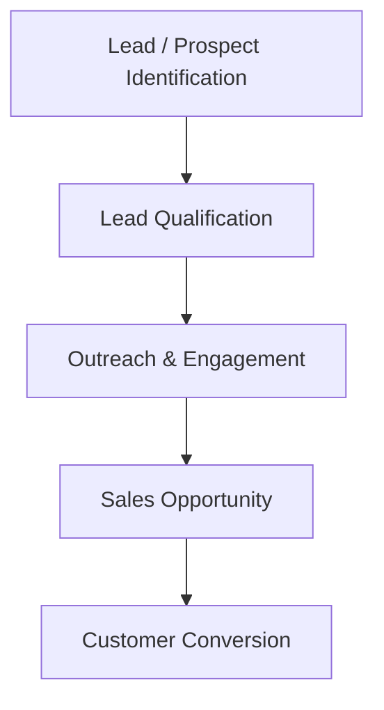
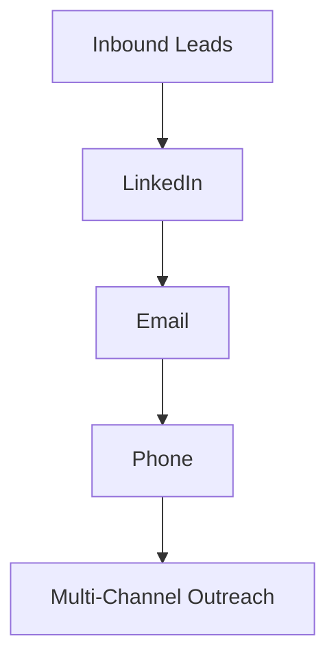
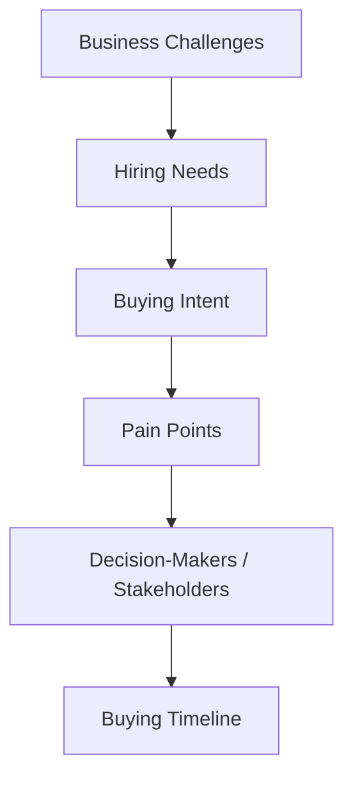

# *Company Type/ Size:*

Peoplebox.ai is a B2B SaaS company operating in the HR Tech sector, providing organizations with solutions for performance management, OKRs, employee engagement, and related HR processes. Founded in 2018 and headquartered in Bengaluru, the company currently has around **35 employees**. Despite its relatively lean team size, **Peoplebox.ai serves 600+ companies**, making it a good example of a small but established B2B SaaS company with a potentially active sales and customer-acquisition function.

---
## *Target Customers / ICP:*

Based on Peoplebox’s current positioning, its sweet spot is **100–1,000 employee companies**, particularly organizations with structured HR/performance-management needs. The main buyers are **HR leaders / People leaders**, while founders, CEOs, and business leaders can also be stakeholders.

---
# *Sales Process:*

Peoplebox.ai follows a **B2B SaaS sales process involving both inbound and outbound sales activities**. The company has a dedicated **Sales Development Representative (SDR) function** responsible for qualifying leads, engaging with potential customers, reviving dormant opportunities, and supporting the movement of qualified prospects through the sales pipeline. Its sales approach is focused on identifying suitable businesses, understanding their requirements, engaging relevant decision-makers, and converting qualified prospects into sales opportunities and customers.

## *Relevance to AI SDR:*

The presence of dedicated SDRs and activities such as **lead qualification, prospect engagement, dormant-lead revival, and outreach** indicates areas where an AI-powered SDR could potentially automate repetitive tasks and support the sales team.

---

# *Prospect Identification & Research:*

Peoplebox.ai uses a combination of **inbound lead generation and outbound prospecting** to build its sales pipeline. Its SDR team works with Marketing, Account Executives, and leadership to identify and nurture relevant business prospects. The company’s SDR role involves engaging prospects through multiple channels, including **phone, email, LinkedIn, and other outreach channels**. SDRs also conduct discovery conversations to understand a prospect’s **business challenges, hiring needs, buying intent, and qualification criteria**.

For prospect research and qualification, the sales team gathers information about the prospect’s **current processes, business goals, pain points, stakeholders, objections, and buying timelines**. The company also maintains **CRM records and detailed handoff notes** so that qualified opportunities can be passed to Account Executives with relevant context. 

## *Key Prospecting Channels*

## *Key Research Areas:*

---

# *Tools Currently Used:*

Peoplebox.ai's sales team uses a combination of CRM, prospecting, and AI-powered sales tools as part of its sales workflow. Its current SDR job posting specifically mentions **HubSpot, Apollo, and Clay**, with AI tools such as **Claude and ChatGPT** being used for research, message drafting, and list building. The role also involves maintaining accurate **CRM records** and managing multi-channel outreach through phone, email, LinkedIn, and text.

The company also has documented integrations with **HubSpot and Salesforce**, indicating that these CRM platforms are part of its broader business-data and sales infrastructure.

### Key tools Identified:

- **HubSpot** — CRM and sales pipeline management
- **Apollo** — Prospecting and lead generation
- **Clay** — Prospect research and list building
- **Claude / ChatGPT** — AI-assisted research and message drafting
- **Salesforce** — CRM/business-data integration
---

# *Biggest Pain Points:*

Peoplebox.ai’s SDR workflow involves several activities that can become time-consuming and repetitive, particularly **prospect research, lead qualification, list building, personalized outreach, and CRM management**. The use of multiple tools such as HubSpot, Apollo, Clay, and AI assistants also suggests that prospecting and research are spread across different parts of the sales workflow.

A key potential challenge is the **manual effort required to research and qualify prospects before outreach**. SDRs need to understand a prospect’s company, business requirements, pain points, stakeholders, and buying intent before deciding how and when to engage them. Managing this information across multiple tools can also create additional data-entry and workflow overhead.

---

# *Time/Cost Involved:*

Peoplebox.ai’s SDR role involves **high-volume cold calling, deep prospect research, and personalized multi-channel outreach**. A current SDR posting states that the role targets **40–60 conversations per week** with US and Middle East prospects and requires researching prospects before calls, including their company, hiring pain, recent triggers, and buying signals.

This means a significant portion of an SDR’s working time can be spent on repetitive activities such as **finding prospects, researching accounts, identifying buying signals, preparing personalized messages, and maintaining CRM information**. The exact internal time spent by Peoplebox has not been publicly disclosed, so it should not be presented as a confirmed company-specific figure.

As a general cost benchmark, SDR salaries in India are currently around **₹6–10 lakh per year in base pay**, with an average base of approximately ₹7 lakh, before considering additional compensation.

### **Potential cost implication:**

If an AI-powered SDR can automate a meaningful portion of prospect research, qualification, list building, and personalization, it could reduce the amount of manual SDR time required for these activities while allowing human SDRs to focus more on conversations and qualified opportunities.

This is a **strong validation point**, bro, because we have an actual Peoplebox job description showing that they're investing human SDR time specifically into the activities our product wants to automate.

---

# *Pay for a Better Workflow:*

Peoplebox.ai’s SDR role requires **30+ dials per day**, **40–60 prospect conversations per week**, and **deep research before each call**. SDRs are expected to research a prospect’s company, pain points, recent triggers, and buying signals, while also creating personalized multi-channel outreach.

This indicates that a significant amount of SDR time is spent on **prospect research, list building, qualification, personalization, and outreach preparation** before a qualified meeting is booked. Peoplebox also uses tools such as **Claude, ChatGPT, Apollo, and Clay** to improve efficiency in research, message drafting, and list building.

The exact internal cost of this workflow has not been publicly disclosed. However, because Peoplebox maintains a dedicated SDR function and invests in multiple sales and AI tools, there is an identifiable **human and software cost associated with its prospecting workflow**.

### **Potential cost opportunity:** 

An AI-powered SDR could reduce the manual time spent on prospect discovery, research, qualification, and personalization, allowing human SDRs to focus more on conversations and qualified opportunities.

---

# Source:

- https://help.peoplebox.ai/hc/peoplebox-help-center/articles/1721735808-hubspot-integration?utm

- https://cleartalk.peoplebox.ai/hc/peoplebox-help-center/en/categories/integrations?utm

- https://www.peoplebox.ai/about-us/?utm

---

